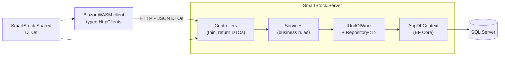

# SmartStock

A small inventory and sales system built as a 15-day backend-first learning project. It has an ASP.NET Core Web API with EF Core (SQL Server), and a Blazor WebAssembly client.

## What it does
- Products and categories, with paging, search and sorting
- Sales orders that check stock, create an invoice, and write stock movements in one transaction
- Stock is a ledger: it is the sum of `StockMovements` rows, never an edited number
- A reporting view (`vw_SalesSummaryByProduct`) and report endpoints
- A Blazor client with a product list page and a place-order form

## Tech
- .NET 8, C# 12
- ASP.NET Core Web API, Swagger
- EF Core 8 (Code First) with SQL Server
- ASP.NET Core Identity (roles `Admin` and `Staff`)
- Blazor WebAssembly client
- xUnit and in-memory SQLite for tests

## Project layout
| Project | Purpose |
|---|---|
| `SmartStock.Server` | API, EF Core, services, repositories, migrations |
| `SmartStock.Client` | Blazor WebAssembly client |
| `SmartStock.Shared` | DTOs shared by the server and the client |
| `SmartStock.Tests` | xUnit tests |

The data model is in [docs/erd.md](docs/erd.md).

## Getting started

Works with any editor (Visual Studio, VS Code, Cursor, Rider) or just a terminal. All commands run from the repository root.

### Requirements
- [.NET 8 SDK](https://dotnet.microsoft.com/download/dotnet/8.0)
- A SQL Server instance:
  - **Windows:** SQL Server LocalDB (installed with Visual Studio) is the easiest option.
  - **macOS / Linux:** SQL Server in Docker, or any SQL Server you can reach. Use its connection string in step 2.
- The EF Core command-line tool:

  ```bash
  dotnet tool install --global dotnet-ef --version 8.*
  ```

### 1. Trust the HTTPS development certificate (once)

```bash
dotnet dev-certs https --trust
```

### 2. Set the connection string

The connection string is not stored in the repo. Keep it in user-secrets:

```bash
dotnet user-secrets set "ConnectionStrings:DefaultConnection" "Server=(localdb)\mssqllocaldb;Database=SmartStockDb;Trusted_Connection=True;MultipleActiveResultSets=true" --project SmartStock.Server
```

For a different SQL Server, put your own connection string in place of the LocalDB one.

### 3. Create the database

```bash
dotnet ef database update --project SmartStock.Server
```

### 4. Run the API and the client

Open two terminals.

**Terminal 1, the API:**

```bash
dotnet run --project SmartStock.Server --launch-profile https
```

**Terminal 2, the client:**

```bash
dotnet run --project SmartStock.Client --launch-profile https
```

| What | URL |
|---|---|
| Swagger (API) | https://localhost:7067/swagger |
| Blazor client | https://localhost:7075 |

The client pages are `/products` (paged list) and `/order` (place an order).

In Development, the API also loads sample data (customers, suppliers and about 30 products) the first time it starts. This never runs in other environments.

> In Visual Studio you can instead set both projects to start together (right-click the solution, **Configure Startup Projects**) and press F5.

## Run the tests

```bash
dotnet test
```

The tests use an in-memory SQLite database, so they need no SQL Server.

## Design decisions
- **Transactions:** `PlaceSalesOrderAsync` runs inside an execution strategy and a transaction, so a failure leaves no partial data.
- **Stock guard and locking:** each product row is locked with `UPDLOCK, HOLDLOCK` (SQL Server only) before stock is checked, so two orders can't both take the last unit. A race test of 5 simultaneous orders against 5 units of stock gave 3 successes and 2 rejections.
- **Ledger, not a stock column:** every stock change is a row, so the history can explain any balance.
- **DTOs only:** the API never returns entities.
- **Soft delete and auditing:** `Product`, `Customer` and `Supplier` are hidden, not removed, and `CreatedAt` / `UpdatedAt` are filled automatically.
- **Concurrency:** `RowVersion` on products and orders, with `DbUpdateConcurrencyException` returned as a 409.
- **Money rules in the database:** check constraints for non-negative prices and quantities, and computed `LineTotal` columns.

## Architecture overview



- **Controllers** only translate HTTP to a service call and back. A `BusinessRuleException` becomes a 400, a duplicate SKU or a concurrency conflict becomes a 409.
- **Services** hold the business rules, such as the stock guard in `PlaceSalesOrderAsync`.
- **`IUnitOfWork`** wraps the repositories and gives services one place for `SaveChangesAsync`, transactions and the product lock.
- **`AppDbContext`** applies one `IEntityTypeConfiguration` per entity, and fills audit dates and soft delete in `SaveChanges`.
- **`SmartStock.Shared`** holds the DTOs, so the client and the server always agree on the JSON shape.
- **The client** never builds URLs in pages. `ProductApiClient` and `OrderApiClient` do that.

### What happens when an order is placed

1. `POST api/Orders` reaches `OrdersController`.
2. `OrderService` merges duplicate product lines and sorts them by product id.
3. Inside one transaction it loads the customer, then for each line it locks the product, reads the stock from the ledger, and rejects the order if there isn't enough.
4. It saves the order and its lines, adds one `SaleOut` stock movement per line, then adds the invoice.
5. The controller returns 201 with the order id, the invoice number and the total.

If anything fails, the transaction rolls back and nothing is saved.

## Lessons learned

- **A ledger beats a stored number.** Because stock is the sum of `StockMovements`, every unit is explained by a row, and there is no "current stock" value to overwrite or corrupt.
- **Lock, then check.** Reading the stock first and writing later lets two orders take the same last unit. Locking the product row before the check closed that gap, and a race test confirmed it.
- **Prove tests are real.** I broke the code on purpose (loosening the stock check, then removing the order lines) and watched the right tests fail. A test I have never seen fail proves little.
- **SQLite is close to SQL Server, not the same.** `UPDLOCK`, `HOLDLOCK` and `RowVersion` are SQL Server features, so the tests skip them. What the tests cannot cover has to be checked by hand on SQL Server.
- **A guard must match its own data.** My first seeder skipped itself because one customer already existed, so nothing was added. It should only look for its own rows.
- **Migrations are code to review.** I read every `Up()` and `Down()`, and practised `Remove-Migration`, rolling back and forward, and a migration bundle before needing them for real.
- **Don't trust a green screen.** The 409 path on the order endpoint never happens in practice because of the locking, so I tested it by forcing the exception and wrote that down honestly.

## Known limits
- No login or authorization yet. Roles exist, but the endpoints are open.
- The locking is SQL Server only, so the tests cannot prove the race protection.
- The 409 response on the order endpoint was only tested with a forced exception, because the row locking prevents the real race.
- The client has a product list and an order form only.

See [roadmap.md](roadmap.md) for the full self-review and the v2 plan.

## Learning log
Day-by-day notes are in [LEARNING-LOG.md](LEARNING-LOG.md).