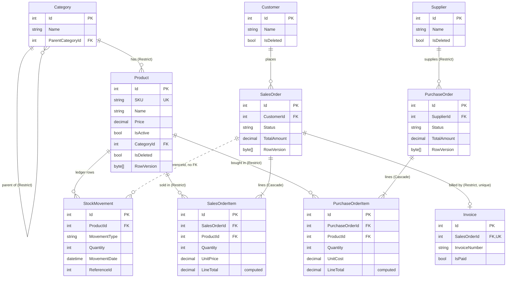

# SmartStock ERD

## Notes
- Stock is never stored on `Product`. It is the sum of `StockMovement` rows (`SaleOut` subtracts, everything else adds).
- `Product`, `Customer` and `Supplier` are soft-deleted and hidden by global query filters.
- `Invoice.SalesOrderId` has a unique index, which makes the relationship one-to-one.
- `ReferenceId` points at the sales or purchase order that caused the movement, but it has no foreign key.
- `vw_SalesSummaryByProduct` is a keyless view for reporting and isn't drawn.
- ASP.NET Identity tables (`AspNetUsers`, `AspNetRoles` and so on) are left out.